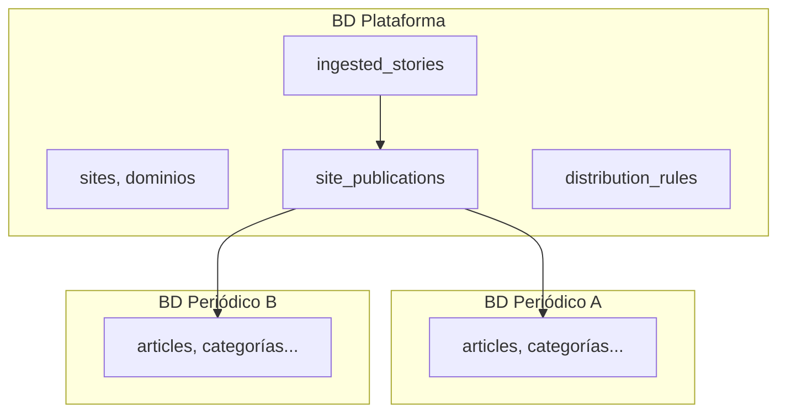

# MyMediaCMS — Arquitectura

Documento de referencia (Fase 0). Modelo revisado: **BD Plataforma + BD por periódico**.

## 1. Visión

Plataforma monolito modular multi-periódico: un despliegue, código compartido, **bases de datos separadas** por medio y **BD plataforma** para registro, ingesta y distribución.

## 2. Stack

| Capa | Tecnología |
|------|------------|
| Backend | PHP 8.3, Symfony 7.2 |
| ORM | Doctrine (2 Entity Managers) |
| API | REST `/api/v1/*` (API Platform en fase 2) |
| BD | MariaDB 11.4 |
| Cache/Queues | Redis 7 (opcional) + Symfony Messenger; sin Redis: filesystem + `sync://` |
| Frontend público | Twig, HTML/CSS mínimo |
| Contenedores | Docker Compose |

## 3. Multi-periódico: BD Plataforma + BD Sitio

**Por qué no BD editorial compartida:** aislamiento, backups independientes, escalado por medio, menor riesgo cross-tenant.

**Por qué sí BD plataforma:** HimtecMedia canónico una vez, reglas globales, asignación multi-medio sin duplicar cuerpo en N BDs hasta publicar.

## 4. Resolución de sitio

1. Request HTTP → dominio → `SiteContextResolver` → `sites` + `site_domains` (plataforma).
2. `SiteContextHolder` almacena contexto de request.
3. Operaciones editoriales → `SiteEntityManagerFactory` → conexión dinámica vía `SiteConnectionManager`.

## 5. HimtecMedia (pipeline)

| Fase | Estado |
|------|--------|
| Recepción API | ✅ Fase 0 |
| JSON Schema | Esquema v1 definido; validación en fase 3 |
| Cola async | Infra lista (Messenger + Redis; configurable a sync sin Redis) |
| Reglas + multi-sitio | Fase 4 |
| Publicación en BD sitio | Fase 3 |

Flujo objetivo:

`HimtecMedia → API → cola → validar → normalizar → dedup → reglas → site_publications → artículo en BD sitio`

## 6. Migraciones

| Tipo | Ubicación | Comando |
|------|-----------|---------|
| Plataforma | `migrations/platform/` | `php bin/console doctrine:migrations:migrate` |
| Sitio | Schema via Doctrine | `php bin/console migrate:site --code=demo` |
| Todos los sitios | — | `php bin/console migrate:sites` |
| Nuevo periódico | — | `php bin/console site:create` |

## 7. Módulos (`src/`)

- `Core/Site` — contexto, conexiones, factory EM
- `Entity/Platform` — entidades BD plataforma
- `Entity/Site` — entidades BD periódico (schema homogéneo)
- `Ingestion/HimtecMedia` — ingesta desacoplada
- `Editorial`, `Rules`, `Theme`, `Seo`, `Advertising` — fases posteriores

## 8. Docker

Servicios: `nginx`, `php`, `worker`, `mysql`, `redis`.

Redis es **opcional**: en hosting sin Redis, `CACHE_APP_ADAPTER=cache.adapter.filesystem_tag_aware` y `MESSENGER_TRANSPORT_DSN=sync://` (sin worker). Ver `.env.example`.

Health: `/health/live`, `/health/ready`.

## 9. Seguridad (evolución)

- Fase 0: ingest endpoint abierto (dev); producción requiere API key + HMAC.
- Contraseñas BD sitio en `site_database_config` — migrar a cifrado con vault/sodium.

## 10. Roadmap

Ver `docs/architecture/ROADMAP.md`.
